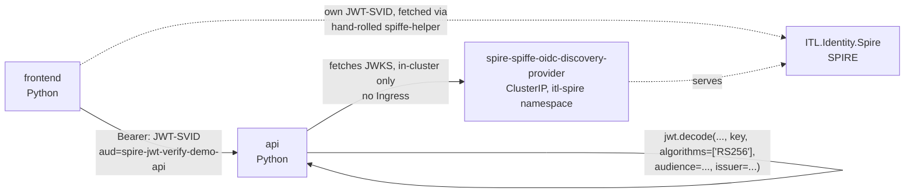

# spire-jwt-verify-demo

A second, deliberately narrower example than [`svid-toggle-demo`](../svid-toggle-demo): two
workloads (frontend → api), one identity mechanism (JWT-SVID), verified **for real** - no
Keycloak, no [`ITL.AuthGateway`](https://github.com/ITlusions/ITL.AuthGateway), no Ingress, no
oauth2-proxy, no browser login at all.

## Why this exists as a separate chart, not another toggle

`svid-toggle-demo`'s api explicitly **does not** verify a JWT-SVID's signature - it decodes the
claims and trusts them, by design, to keep that chart's own code short. That chart's README also
documents an attempt to close that gap a different way: exchange the JWT-SVID for a real
Keycloak access token (RFC 7523), so the api could lean on Keycloak's own signature checking
instead of doing its own. That attempt hit a genuine Keycloak-side limitation (its
`federated-jwt` client authenticator could not be made to resolve this chart's client at all,
confirmed live via Keycloak's own event log even with an exact issuer/subject match) and ships
disabled - see that chart's own §5.

This chart is the other way to close the same gap: **verify the signature directly, in the
api's own code, against SPIRE's own JWKS.** No new trust relationship with Keycloak, no new
client to register, no platform mechanism to fight - just real cryptography, a library call
away.

## The chain, end to end



## 1. The frontend's JWT-SVID

Identical mechanism to `svid-toggle-demo`'s own `jwt-svid-helper` init container
(`templates/jwt-helper-configmap.yaml`, `templates/frontend-deployment.yaml`) - a hand-rolled
`spiffe-helper` sidecar, not `ITL.Kyverno`'s annotation (same reasoning as that chart: the
Kyverno policy only ever fetches an X.509-SVID). Fetches a JWT-SVID scoped to
`spire-jwt-verify-demo-api` and writes it to `/jwt-svid/jwt_svid.token`; the frontend reads it
and sends it as `Authorization: Bearer <token>`.

No dedicated `ClusterSPIFFEID` in this chart at all - relies entirely on
`ITL.Identity.Spire`'s own cluster-wide `default` registration (`fallback: true`, every
namespace except `itl-spire`/`spire-server`/`spire-system`), unlike `svid-toggle-demo`'s own
`clusterspiffeid.yaml`. That chart needed its own because it has a DNS-name requirement and two
workloads sharing one identity under different `app.kubernetes.io/name` labels; this chart has
neither, so the cluster default is sufficient as-is.

## 2. Real signature verification (`templates/api-deployment.yaml`)

The api fetches the trust domain's JWKS from `ITL.Identity.Spire`'s own OIDC discovery provider
- **in-cluster only**, no Ingress involved:

```
http://spire-spiffe-oidc-discovery-provider.itl-spire.svc.cluster.local/keys
```

That `ClusterIP` Service already exists regardless of this chart (confirmed live in
`ITL.Identity.Spire`'s own `docs/1-operations/1.3-oidc-discovery.md`) - the api being inside the
same cluster means it never needed the public `trust.itlusions.com` hostname that chart's own
Ingress exists for. One fewer public hostname to depend on for a purely internal call.

Verification itself is one `PyJWT` call
(`jwt.decode(token, key=signing_key, algorithms=['RS256'], audience=AUDIENCE, issuer=ISSUER)`),
preceded by matching the token's unverified header `kid` against the fetched JWKS to pick the
right public key - `PyJWT[crypto]` (the `cryptography`-backed extra, not bare `PyJWT`) is what
actually does the RSA verification; without it, `algorithms=['RS256']` raises instead of
verifying anything. This single call replaces everything `svid-toggle-demo`'s own
`decode_jwt_claims` + `authenticate_jwt_svid` hand-roll *and* skip: real signature check, plus
library-enforced (not hand-rolled) audience/issuer/expiry checks.

The JWKS is cached for 5 minutes per `kid`, not re-fetched on every request - SPIRE rotates its
signing keys on its own schedule (confirmed live: a server log line reading `"JWT key
activated"` with an expiration several hours out), so a cache with a bounded lifetime, not an
unbounded one, is the right shape here.

## Deploy

```bash
cd itl.identity.spire/examples/spire-jwt-verify-demo
helm install jwt-verify . -n spire-jwt-verify-demo --create-namespace
```

Requires, live on the cluster beforehand: `ITL.Identity.Spire` deployed with a trust domain
matching `values.yaml`'s `svid.trustDomain`/`svid.className`, and its
`spiffe-oidc-discovery-provider` enabled (it is, by upstream's own default - see that chart's
own values.yaml comment). No `ITL.CertManager.CA`, no Keycloak, no `ITL.Kyverno` policy needed -
this chart's dependency footprint is deliberately smaller than `svid-toggle-demo`'s.

## Verify

```bash
# A genuine 200, with a real "verified": true - this call's signature was actually checked,
# not decoded-and-trusted.
kubectl exec -n spire-jwt-verify-demo deploy/jwt-verify-frontend -c frontend -- python3 -c \
  "import urllib.request; print(urllib.request.urlopen('http://localhost:8080/').read().decode())"
# api responded 200: {"called_by": "spiffe://itlusions.local/ns/spire-jwt-verify-demo/sa/default", "verified": true}

# Tamper with the token (flip one character in the signature) and confirm the api actually
# rejects it - the one check that proves this chart isn't just decoding-and-trusting under a
# different name.
kubectl exec -n spire-jwt-verify-demo deploy/jwt-verify-frontend -c frontend -- python3 -c "
import urllib.request, urllib.error
token = open('/jwt-svid/jwt_svid.token').read().strip()
tampered = token[:-1] + ('A' if token[-1] != 'A' else 'B')
req = urllib.request.Request('http://jwt-verify-api:8081/whoami')
req.add_header('Authorization', 'Bearer ' + tampered)
try:
    urllib.request.urlopen(req, timeout=5)
    print('WRONG: tampered token was accepted')
except urllib.error.HTTPError as e:
    print('correctly rejected: %d %s' % (e.code, e.read().decode()))
"
# correctly rejected: 401 JWT-SVID verification failed: verification failed: Signature verification failed
```
