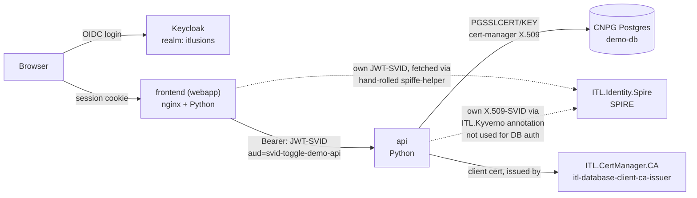

# svid-toggle-demo

A three-tier app (frontend → api → database) demonstrating **four separate identity mechanisms**,
each used only where it actually fits, with no overlap between them:

| Hop | Mechanism | Purpose |
|---|---|---|
| Browser → frontend | Keycloak (OIDC, via [`ITL.AuthGateway`](https://github.com/ITlusions/ITL.AuthGateway)) | *Which human* is using this app |
| frontend → api | JWT-SVID (SPIFFE, hand-rolled `spiffe-helper`) | *Which workload* is calling this endpoint |
| api → database | X.509 via [`ITL.CertManager.CA`](https://github.com/ITlusions/ITL.CertManager.CA) | CNPG's `clientcert=verify-full`, which only understands classic CN-matching certs |
| api (standalone) | X.509-SVID (SPIFFE, via [`ITL.Kyverno`](https://github.com/ITlusions/ITL.Kyverno)'s annotation) | Demonstrates the reusable injection pattern - not consumed by anything in this chart |

`svid.enabled` is still the one toggle that turns the SPIFFE/cert-manager layers on or off
together - the Keycloak layer (webapp-ingress.yaml, auth-gateway.yaml) is independent of it and
always active once deployed.

## The chain, end to end



## 1. Keycloak login on the frontend

[`ITL.AuthGateway`](https://github.com/ITlusions/ITL.AuthGateway) (`oauth2-proxy` + a Traefik
`forwardAuth` Middleware + a `KeycloakOIDCClient` CR) protecting the frontend's own Ingress - this
example is that library chart's **first real consumer**, confirmed live, with several of its own
open questions resolved along the way:

- **The Keycloak Operator does not generate the OIDC client's secret** - it *reads* whatever value
  already sits in the referenced Secret's `client-secret` key and pushes that to Keycloak,
  erroring (`auth.secret: must not be blank`) if it's empty. This chart generates that value
  itself (`templates/oidc-client-secret.yaml`), via Helm's `lookup` function so the value is
  **stable across upgrades** (reusing whatever's already there, falling back to `randAlphaNum 32`
  only on first install) - rotating it on every `helm upgrade` would silently invalidate every
  active browser session.
- **The Secret needs the `client-secret` key to exist already**, even as an empty placeholder -
  the operator updates an existing key's value, it does not add a new key to a Secret that lacks
  one.
- **`openssl` isn't in `alpine/k8s`** (confirmed live: `openssl: not found`) - the cookie-secret
  generation Job (`templates/oauth2-proxy-secret-job.yaml`) uses `/dev/urandom` + `base64` instead.
- **A naive "reuse the existing secret across upgrades" check broke itself once already**: it
  checked only whether the Secret *existed*, not whether its value was actually non-empty - which
  meant a single bad run (the `openssl`-missing failure above) kept perpetuating an empty cookie
  secret forever, since every subsequent run "reused" that same empty value. Fixed by checking for
  non-empty specifically, not merely present.
- **The oauth2-proxy *Service* name is `{{ .Chart.Name }}-authgw`, not `{{ .Release.Name }}-authgw`**
  (`itl-authgateway.fullname`'s own naming convention) - got this wrong twice (the Ingress backend
  and the redirect Middleware both pointed at a nonexistent Service) before checking the library
  chart's actual helper.
- **Real TLS, not a self-signed placeholder**: `webapp.host` (`svid-demo.itlusions.com`) gets a
  genuine Let's Encrypt certificate via this cluster's existing `letsencrypt-issuer` (DNS-01, the
  same TransIP webhook every other app here uses) - external-dns picks up the new hostname
  automatically, no manual DNS record needed.
- **Known, still-open limitation**: Traefik's `errors` Middleware (`templates/webapp-ingress.yaml`
  - not part of `ITL.AuthGateway` itself, which only provides the bare `forwardAuth` check) is
  meant to turn `forwardAuth`'s own `401` into a redirect to Keycloak's login page by serving
  oauth2-proxy's `/oauth2/start` response in its place. Confirmed live: `/oauth2/start` itself
  correctly returns a real `302` to Keycloak when called directly, and the `errors` Middleware
  does correctly substitute its *body and headers* (including the `Location` header) into the
  `401` response - but Traefik deliberately keeps the *original* status code (`401`) on the
  response it actually sends, by design (an "error page" is content for an error, not a status
  override). A browser does not follow a `Location` header on a non-3xx response, so this
  currently does not produce an automatic redirect for a real user, only the right *content* at
  the wrong status code. Not yet resolved - would need a different mechanism than `errors` (a
  small redirect-serving backend of its own, or a Traefik version/feature that supports rewriting
  the status code too) to actually fix the browser UX.
- **Middleware chain order matters, and the "obvious" order is wrong**: `forwardAuth` short-
  circuits the whole chain on a non-2xx response, so anything listed *after* it in
  `router.middlewares` never runs - including `errors`. It has to be listed *first* so it wraps
  `forwardAuth`'s own response, not the reverse ("check the session, then catch what it returns"),
  which seems more intuitive but simply never invokes the second middleware at all.

## 2. JWT-SVID: frontend calling the api

The frontend's own `spiffe-helper` sidecar (`templates/webapp-deployment.yaml`,
`jwt-helper-configmap.yaml`) fetches a JWT-SVID scoped to audience `svid-toggle-demo-api` - the
*same* SPIRE registration (`clusterspiffeid.yaml`) the X.509-SVID path uses, just a different SVID
type requested from it (JWT-SVIDs need no separate registration entry). The frontend sends it as
`Authorization: Bearer <token>` when calling the api's `/data` endpoint
(`templates/api-deployment.yaml`).

**Hand-rolled, not `ITL.Kyverno`'s `spiffe-helper-inject` annotation** - that policy's own config
only ever fetches an X.509-SVID (see its own `templates/spiffe-helper-inject.yaml`), not a JWT
one. Kept local to this one chart rather than extending the shared, reusable Kyverno policy for a
need only this example has so far.

The api decodes the JWT's claims (audience, expiry) to authenticate the caller - **it does not
verify the token's cryptographic signature** against SPIRE's trust bundle. A real relying party
would fetch the trust domain's JWKS via the Workload API and actually verify it; skipped here
deliberately to keep this example's own code short, not because it would be hard to add.

## 3. X.509 via `ITL.CertManager.CA`: api connecting to the database

The api's hop to Postgres (`cnpg-cluster.yaml`, `client-certificate.yaml`) uses
`ITL.CertManager.CA`'s `itl-database-client-ca-issuer` - a completely separate CA from SPIRE's
root, decoupled from SPIFFE entirely. **This is the mechanism that actually authenticates to
Postgres** - everything else in this chart's identity story is either informational (the api's own
X.509-SVID, below) or authenticates a different hop (the frontend's JWT-SVID, above).

See `ITL.CertManager.CA`'s own docs
(`docs/1-overview/1.4-cnpg-compatibility.md`) for the five real CNPG-compatibility bugs found
building that chart - `ca.key` missing, `ca.crt` holding the wrong certificate, the client's
presented chain needing the root bundled in too, CNPG's own internal signing being ECDSA-only
(confirmed by reading its source), and Secret file permissions (`fsGroup` + `defaultMode`, both
required, neither alone sufficient).

A copy-paste mistake found live in *this* chart while wiring the api up to this same CA: its own
`server-ca` volume (which verifies the *server's* certificate, a separate role from
`clientCASecret`) initially pointed at the wrong secret (`db-combined-client-ca`, the client CA)
instead of CNPG's own auto-generated server CA (`<release>-db-ca`) - produced `SSL error:
certificate verify failed` on the connecting client specifically, not a server-side rejection,
which is what made it findable: the server accepted the client cert fine, the client just didn't
trust the server's.

## 4. X.509-SVID via `ITL.Kyverno`: demonstrated, not consumed

The api pod also carries the annotation `spiffe.itlusions.local/inject: "true"`
(`api-deployment.yaml`), getting the exact same SPIFFE X.509-SVID sidecar
`ITL.Openproject.fork` hand-rolled, via `ITL.Kyverno`'s reusable `spiffe-helper-inject`
`ClusterPolicy` instead. **Nothing in this chart actually reads the resulting certificate** - it
exists purely to show the annotation-based injection pattern working on a real workload,
independent of whatever that workload's own identity story for its *other* hops happens to be
(here, cert-manager for Postgres, JWT-SVID for inbound auth).

## Deploy

```bash
cd itl.identity.spire/examples/svid-toggle-demo
helm dependency update   # resolves the ITL.AuthGateway local-path dependency - see Chart.yaml's own comment on why file://
helm install demo . -n svid-demo --create-namespace --set svid.enabled=true
```

Requires, live on the cluster beforehand: `ITL.Kyverno`'s `spiffe-helper-inject` policy enabled,
`ITL.CertManager.CA` deployed, and `ITL.Identity.Spire` deployed with a trust domain matching
`values.yaml`'s `svid.trustDomain`/`svid.className`.

## Verify

```bash
# 1. The api's own JWT validation + DB query, called directly (bypassing the frontend)
kubectl exec -n svid-demo deploy/demo -c webapp -- python3 -c \
  "import urllib.request; print(urllib.request.urlopen('http://localhost:8080/').read().decode())"
# "api responded 200: {"called_by": "spiffe://...", "db_user": "svid-toggle-demo", "db_time": "..."}"

# 2. The api's own SPIFFE X.509-SVID, confirming ITL.Kyverno's injection worked
kubectl get pod -n svid-demo -l app.kubernetes.io/name=svid-toggle-demo-api \
  -o jsonpath='{.items[0].spec.initContainers[*].name}'
# spiffe-helper spiffe-helper-config-writer wait-for-db

# 3. Keycloak login - confirm the OIDC client exists and is error-free
kubectl get keycloakoidcclient svid-toggle-demo -n itl-keycloak -o jsonpath='{.status.conditions}'
# [{"status":"False","type":"HasErrors"}]

# 4. The actual redirect target oauth2-proxy builds (confirms client ID/secret/issuer are all correct)
curl -sk -H "Host: svid-demo.itlusions.com" "https://<traefik-lb-ip>/oauth2/start?rd=/" -i | grep Location
# Location: https://sts.itlusions.com/realms/itlusions/protocol/openid-connect/auth?...client_id=svid-toggle-demo...
```
